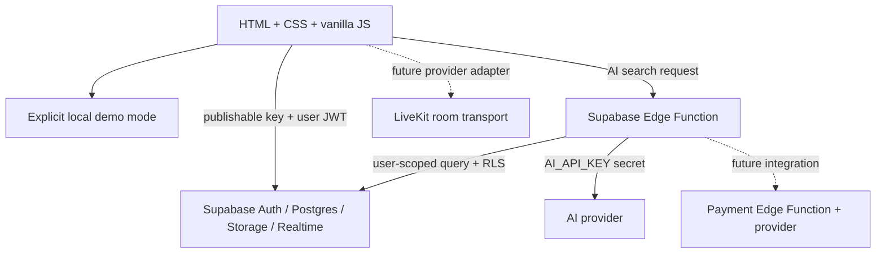

# ZENVORA

**Where Content Meets Commerce.** A responsive social-commerce marketplace prototype built with HTML, CSS and browser-native JavaScript modules. There is no Node/Express application server or Firebase dependency.

## Current status

The storefront remains usable without credentials. The catalog, category filters, sort, text search, product detail, stock-limited local cart, saved products, demo checkout, order confirmation, simulated Reels engagement/chat, and local customer/vendor/admin workspace previews run in the browser and persist to `localStorage`. They are intentionally labeled demo behavior. Demo checkout collects only an email and delivery address, creates a local record and never requests payment details or charges money.

When `js/config.js` contains a Supabase project URL and browser-safe publishable key, the account dialog uses Supabase Auth for email/password sign-up, sign-in, password-reset email, password update, sign-out and vendor applications. New sign-ups request only the customer role. The workspace reads the authenticated user's profile and linked vendor-application status; it does not trust the local demo-role value. Vendor applications are inserted as `pending` and require approval. In configured mode, the storefront reads active categories/products from Postgres, signs private image paths when Storage permits, and shows explicit loading/errors instead of seeded catalog fallback. Customer cart/wishlist state loads from owner-scoped tables; guest cart/saved finds merge after sign-in. Authenticated checkout reserves stock transactionally through Postgres and redirects to a Stripe-hosted Checkout Session created by an Edge Function. A separate Stripe webhook verifies the raw request signature and finalizes payment/idempotency. Demo checkout is blocked in configured mode. Supabase and Stripe flows are implemented but unverified against real projects in this workspace.

The Supabase schema, RLS policies, seed data, storage bucket definitions and AI Edge Function remain integration artifacts. Auth code has not been tested against a configured Supabase project or multiple real accounts in this workspace because no project URL or publishable key is configured. See [TESTING.md](TESTING.md) for the exact verification checklist. Real payment and live-video providers are not configured.

## Architecture



## Project layout

- `index.html`: accessible single-page storefront and content views.
- `css/styles.css`: responsive visual system and layouts.
- `js/data.js`: clearly identified local demo catalog and content.
- `js/app.js`: navigation, local demo cart, product discovery, demo checkout and interactions.
- `js/config.js`, `js/supabase.js`: one lazy-loaded official Supabase JS client; browser-safe publishable key only.
- `js/catalog-service.js`: catalog normalization, per-customer cart/wishlist persistence, and signed published Reel/live media loading.
- `tests/catalog-service.test.mjs`: mocked PostgREST response test for product/category/vendor/variant normalization.
- `supabase/schema.sql`: relational PostgreSQL schema, role helpers and auth profile trigger.
- `supabase/policies.sql`: row-level security policies.
- `supabase/seed.sql`: hierarchical categories, 20 catalog entries with standard variants/inventory and restricted storage buckets.
- `supabase/functions/ai-search/index.ts`: AI query interpretation and RLS-scoped catalog lookup.
- `supabase/functions/create-checkout-session/index.ts`: JWT-verified inventory reservation and Stripe Checkout session creation.
- `supabase/functions/stripe-webhook/index.ts`: Stripe signature verification and payment/order finalization.
- `TESTING.md`: phase-by-phase manual verification checklist and current test status.

## Run the demo

Serve this directory over HTTP (ES modules do not run reliably from `file://`). For example, with Python installed:

```powershell
python -m http.server 8000
```

Open `http://localhost:8000`. Product and category imagery uses remote Unsplash URLs, so the demo needs an internet connection for photography and web fonts.

Run the local adapter check with `node tests/catalog-service.test.mjs`. It uses a mocked Supabase-shaped response and does not test network access, database policies or a live project.

## Supabase setup

1. Create a Supabase project.
2. Apply `supabase/schema.sql`, then `supabase/policies.sql`, then `supabase/seed.sql` in the SQL editor (or via the Supabase CLI).
3. Keep email/password confirmation settings appropriate for the deployment. The auth trigger always assigns a new account the customer role; public signup cannot grant vendor or admin privileges. A vendor application starts pending and requires an administrator to approve it. Assign the first administrator through a trusted SQL/editor workflow, never browser metadata.
4. Put the project URL and publishable key in `js/config.js` for a direct static deployment. Browser ES modules cannot read `.env`; the example file is a deployment checklist, not runtime configuration. `SUPABASE_PUBLISHABLE_KEY` is designed to be public; RLS, not key secrecy, is the authorization boundary. Never put a service-role key in frontend code.
5. Run `supabase functions deploy ai-search`, then configure `AI_API_KEY` and optionally `AI_MODEL` using Supabase Edge Function secrets. The function accepts optional user authorization and queries products through an anon client so normal RLS policies remain effective.
6. For hosted payments, create a Stripe account in test mode, set Edge Function secrets `STRIPE_SECRET_KEY`, `STRIPE_WEBHOOK_SECRET`, `SUPABASE_SERVICE_ROLE_KEY`, and `PUBLIC_APP_URL`, then deploy `create-checkout-session` and `stripe-webhook`. Configure the Stripe webhook URL as `https://<project-ref>.supabase.co/functions/v1/stripe-webhook` and subscribe to `checkout.session.completed`, `checkout.session.async_payment_succeeded`, `checkout.session.async_payment_failed`, and `checkout.session.expired`. Never set Stripe secrets in `js/config.js`. Checkout locks the caller's cart, validates and reserves inventory from database prices, creates vendor-attributed order lines, and redirects to Stripe-hosted checkout; the signed webhook checks idempotency, amount and currency before confirmation or stock rollback.
7. To enable authenticated realtime, add only the intended tables (for example `live_chat_messages`, `live_stream_products`, and `notifications`) to the Supabase Realtime publication after reviewing their RLS policies. The seed creates private `reel-videos`, `reel-thumbnails`, and `live-thumbnails` buckets; apply `policies.sql` so signed media reads and vendor-owned writes work.

`.env.example` documents the safe browser settings and names server-only integration settings; browser modules cannot read a private `.env` file. Set AI/payment secrets in Edge Function secrets, not in `config.js` or static hosting variables exposed to the browser.

## Security and integration notes

- `profiles.role` defaults to `customer`; a trigger ignores any role supplied in signup metadata. Role changes require an admin. Vendor ownership requires an approved `vendor_profiles` row.
- Auth UI relies on Supabase Auth confirmation/reset redirect settings being configured for the deployed site URL. Vendor applicants remain customers until an administrator approves their `vendor_profiles` row and promotes `profiles.role` to `vendor` through a trusted admin workflow.
- Orders have no customer insert policy. Real checkout must be implemented as a server-validated Edge Function/RPC that validates stock and price, reserves inventory transactionally, creates vendor-split order lines and invokes a payment adapter. Payment webhooks must verify signatures server-side.
- Checkout Edge Functions and reservation/payment SQL are implemented, but payment cannot be exercised without applying the updated schema and providing Stripe test secrets plus a public HTTPS `PUBLIC_APP_URL`. Reservations for abandoned Checkout Sessions release on Stripe's `checkout.session.expired` webhook, so webhook delivery/monitoring is required. The SQL has only been statically reviewed, not executed against PostgreSQL here.
- Supabase Storage buckets are private with MIME and size limits. Add `storage.objects` policies before enabling uploads; path ownership should bind the first path segment to `auth.uid()` and vendor media to an approved shop. No broad upload policy is included.
- Realtime subscriptions and LiveKit/Agora transport are not connected in the local demo. Configured Supabase mode loads published Reel videos and active live stream metadata from Postgres, but still reports a clear provider-token configuration state before claiming broadcast functionality.
- The AI function keeps provider credentials server-side and uses the caller's JWT for database queries. It returns a clear unavailable response when its provider secret is not configured. Review model output, query limits, rate limits and AI-provider data retention before production use.
- The SQL policies are a security baseline, not a completed penetration test. Apply migrations to a test project and verify customer-to-customer, vendor-to-vendor, pending-vendor and customer-to-admin denial cases before launch. The demo workspace selectors are not secure role switching.

## Demo interactions

- Search supports product names, maker names, categories and descriptive terms. The AI Edge Function is invoked only when Supabase settings are configured; local search is the transparent fallback.
- Use `Shop`, `Reels`, and `Live` in the top navigation. Product buy buttons open a purchase detail modal so the current content view remains underneath.
- Choose a demo role from `ACCOUNT` to inspect a customer, vendor or admin workspace. Vendor preview can add a browser-local sample item.
- Cart, wishlist, demo orders and demo workspace changes persist only in the current browser's local storage. Clear the browser's site storage to reset them.

## Known limitations / next production steps

Supabase Auth, live public catalog reads, owner-scoped cart/wishlist persistence, guest-state merge, transactional inventory reservation, Stripe Checkout session creation and webhook finalization are implemented but unverified against real projects. RLS/runtime integration tests are not run. Product image signed URLs require Storage object select policies, which are not yet present. Catalog write CRUD, image/video upload, persistent comments/likes/notifications, real vendor/admin data dashboards, LiveKit transport, Realtime subscriptions, AI recommendations/auto-tagging/support remain to be implemented. Stripe requires a test account, configured Edge Function secrets and a reachable webhook endpoint. Seed vendors, customers, content and order records require auth users with known UUIDs; the current seed creates browseable catalog products with inventory variants but no fake identities.